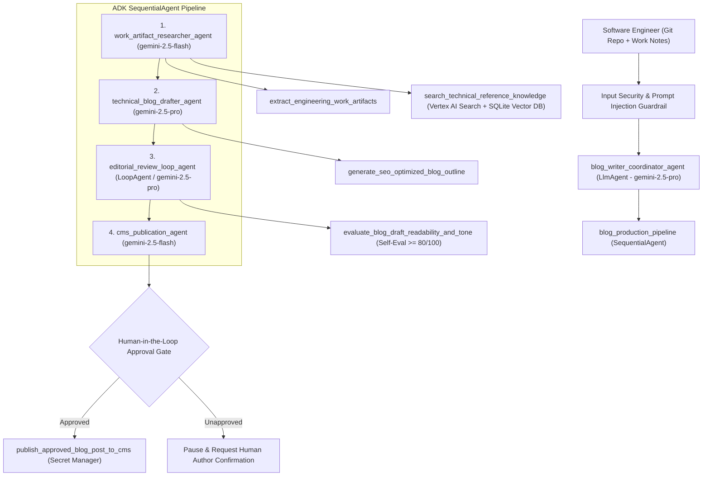

# Work-to-Blog Agent: Automated Engineering Blog Writer (Google ADK)

**Track:** Enterprise & Developer Productivity Agent  
**Framework:** Google Agent Development Kit (`google-adk`), Vertex AI Gemini (`gemini-2.5-pro` & `gemini-2.5-flash`), OpenTelemetry, Cloud DLP, Vertex AI Search, Secret Manager, and Terraform IaC.

---

## 1. Problem & Solution Statement

- **The Problem:** Software engineers ship high-leverage architectural improvements, performance optimizations, and reliability fixes every day, but turning raw commits, diffs, and design notes into polished, factual technical blog posts is too manual and time-intensive. Furthermore, naive LLM blog generators hallucinate metrics or risk leaking internal PII, email addresses, or credentials.
- **The Solution:** **Work-to-Blog Agent** is a multi-agent system built with **Google ADK** that inspects the engineer's real work (git commit history, modified files, and design notes), retrieves style and architecture references from **Vertex AI Search** and a persistent vector store, drafts an SEO-optimized technical article, runs an iterative **Editorial & Safety Review Loop**, scrubs all PII via **Google Cloud DLP**, and enforces a strict **Human-in-the-Loop (HITL)** confirmation gate before publishing.

---

## 2. Multi-Agent Architecture



---

## 3. Agent CLI (`adk` & `agent-starter-pack`) Usage

This repository is structured for native compatibility with the **Google ADK CLI (`adk`)** and **Agent Starter Pack CLI**:

### Install Dependencies

```bash
pip install -e ".[dev]"
```

### Run Interactive Agent UI (`adk web`)

```bash
adk web .
```

### Run Agent in Terminal (`adk run`)

```bash
adk run blog_writer_agent
```

### Run Automated Evaluation via ADK CLI (`adk eval`) & Golden Dataset Harness

```bash
# Run ADK CLI evaluation against evals/blog_writer_eval.test.json
adk eval blog_writer_agent evals/blog_writer_eval.test.json

# Run full Golden Dataset regression harness & unit test suite
python -m evals.run_evals
pytest -v
```

### Deploy to Vertex AI Agent Engine or Cloud Run via Agent CLI (`adk deploy`)

```bash
# Deploy directly to Vertex AI Agent Engine
adk deploy agent_engine \
  --project=$GOOGLE_CLOUD_PROJECT \
  --region=us-central1 \
  --staging_bucket=gs://$GOOGLE_CLOUD_PROJECT-agent-staging \
  blog_writer_agent

# Or deploy to Google Cloud Run via Agent CLI
adk deploy cloud_run \
  --project=$GOOGLE_CLOUD_PROJECT \
  --region=us-central1 \
  --service_name=work-to-blog-agent \
  blog_writer_agent
```

---

## 4. Infrastructure as Code (Terraform)

All cloud resources (Cloud Run v2 service, least-privilege runtime Service Account, IAM bindings, Vertex AI Search Data Store, and Google Cloud Secret Manager secrets) are provisioned reproducibly via Terraform under `terraform/`:

```bash
cd terraform
terraform init
terraform plan -var="project_id=$GOOGLE_CLOUD_PROJECT"
terraform apply -var="project_id=$GOOGLE_CLOUD_PROJECT"
```

---

## 5. AgentOps Code Review Matrix (95 / 95 Points Mapping)

| Category | Criteria (5 pts each) | Code Evidence in Repository |
| :--- | :--- | :--- |
| **1. Tool & Interface Design** | **Comprehensive Tool Docstrings** | `blog_writer_agent/tools/blog_tools.py` — Full Google-style docstrings (`Args`, `Returns`, usage context) on all 5 tools. |
| | **Descriptive Naming** | `extract_engineering_work_artifacts`, `search_technical_reference_knowledge`, `generate_seo_optimized_blog_outline`, `evaluate_blog_draft_readability_and_tone`, `publish_approved_blog_post_to_cms`. |
| | **Explicit JSON Schemas** | `blog_writer_agent/schemas.py` — Strict Pydantic v2 models (`ConfigDict(extra="forbid")`, `Field` regex/bounds) + `export_all_tool_json_schemas()`. |
| | **Guided Error Handling** | `blog_writer_agent/tools/blog_tools.py` — Structured error payloads returning `error_code`, `error_message`, and actionable `recovery_instructions` for LLM self-correction. |
| **2. Context & Memory** | **Robust System Instructions** | `blog_writer_agent/prompts.py` — Explicit `<CONSTITUTION>`, `<PERSONA>`, `<DOMAIN_KNOWLEDGE>`, and `<OPERATIONAL_CONSTRAINTS>` prompts for all 5 agents. |
| | **History Compaction** | `blog_writer_agent/memory/compaction.py` — Token-budget truncation, sliding window turn retention, extractive summarization, ADK `before_model_callback`, and Vertex AI Context Caching (`client.caches.create`). |
| | **Persistent Session State** | `blog_writer_agent/memory/session_store.py` — Persistent SQLite session & vector knowledge store + Vertex AI Search (`google.cloud.discoveryengine_v1`) integration across turns. |
| | **Async Memory Operations** | `blog_writer_agent/memory/async_memory.py` — `AsyncMemoryConsolidationManager` executing background memory compaction and vector indexing via `asyncio.create_task` without blocking UI responses. |
| **3. Orchestration & Logic** | **Multi-Agent Patterns** | `blog_writer_agent/agent.py` — Coordinator `LlmAgent` -> `SequentialAgent` (`blog_production_pipeline`) -> `LoopAgent` (`editorial_review_loop_agent`). |
| | **Strategic Model Routing** | `blog_writer_agent/orchestration/model_router.py` — Routes extraction/publishing to `gemini-2.5-flash` and planning/drafting/critique to `gemini-2.5-pro`, plus dynamic token-complexity callback routing. |
| | **Guardrails & Policy Plugins** | `blog_writer_agent/orchestration/guardrails.py` — Vertex AI `SafetySetting` config, prompt-injection & confidential-marker guardrail callbacks, and automated self-evaluation rubric checks. |
| | **Human-in-the-Loop Hooks** | `blog_writer_agent/orchestration/hitl.py` — `HumanInTheLoopApprovalGate` and `require_human_approval_before_tool_callback` halting `publish_approved_blog_post_to_cms` until human confirmation. |
| **4. Observability & Tracing** | **Structured JSON Logging** | `blog_writer_agent/observability/logger.py` — `PIIRedactingJsonFormatter` emitting structured JSON logs with severity, timestamps, trace/span IDs, and metadata (zero `print` statements). |
| | **Intent vs. Outcome Capture** | `blog_writer_agent/observability/logger.py` — `IntentOutcomeTracker.record_intent()` (pre-execution) and `record_outcome()` (post-execution) paired via `correlation_id`. |
| | **Distributed Tracing** | `blog_writer_agent/observability/tracing.py` — OpenTelemetry `TracerProvider`, `CloudTraceSpanExporter`, `@traced_operation`, and parent-child span linking across workflow and tools. |
| | **PII Redaction** | `blog_writer_agent/observability/pii_redactor.py` — `PIIRedactor` combining Google Cloud Sensitive Data Protection (`dlp_v2`) and regex scrubbing across all logs, drafts, and memory writes. |
| **5. Infrastructure & CI/CD** | **Automated Evaluation Suites** | `evals/golden_dataset.json`, `evals/blog_writer_eval.test.json`, `evals/run_evals.py`, `tests/test_agent_evaluation.py`, and `.github/workflows/ci_eval.yml`. |
| | **Infrastructure as Code** | `terraform/main.tf`, `terraform/variables.tf`, `terraform/outputs.tf`, `Dockerfile`, and ADK CLI documentation in `README.md`. |
| | **Secure Secret Management** | `blog_writer_agent/config/secrets.py` — `SecretManagerProvider` fetching secrets dynamically via `google.cloud.secretmanager_v1` with zero hardcoded keys. |
